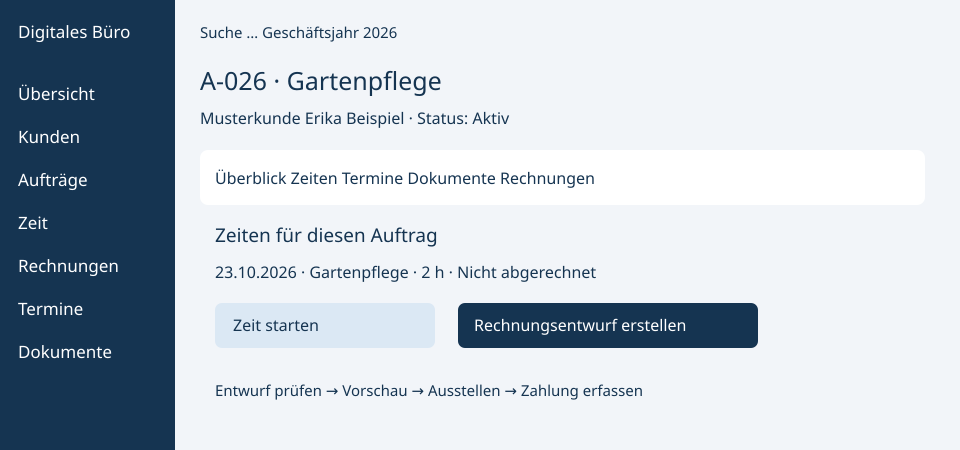
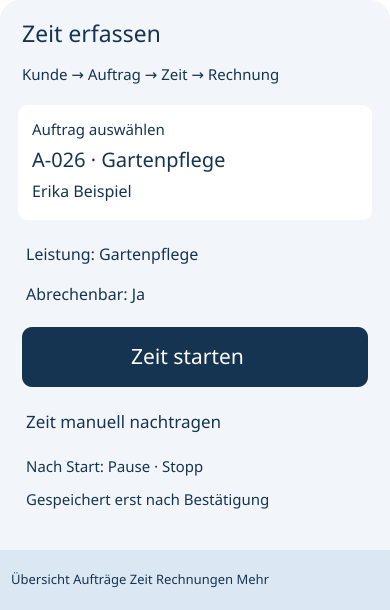

# Oberflächenentwurf 0001: Kunde → Auftrag → Zeit → Rechnung

Datum: 23.10.2026. Status: kleiner fachlicher Entwurf zu [ADR 0001](../decisions/0001-betriebsmodell-und-stack.md), keine implementierte Anwendung. Alle Beispiele sind erfunden. Der Entwurf beschreibt denselben Ablauf für Desktop und Smartphone; keine voneinander getrennten Apps.

## Navigation und Aufbau

Desktop ab etwa 960 CSS-Pixeln: linke Navigation mit Übersicht, Kunden, Aufträgen, Zeit, Rechnungen, Terminen und Dokumenten. Kopfbereich mit Suche, Geschäftsjahr und Benutzer; Inhalt als Liste plus Detailbereich. Darunter ein dauerhaft sichtbarer Timerstatus, falls aktiv.

Smartphone: einspaltig, oben Seitentitel und Suche; unten Übersicht, Aufträge, Zeit, Rechnungen und Mehr. Unter Mehr liegen Kunden, Termine, Dokumente und Einstellungen. Kunde kann direkt beim neuen Auftrag ausgewählt oder angelegt werden. Tabellen wechseln zu Karten, Formulare zu einer Spalte; Rechnungspositionen werden als einzelne Karten bearbeitet. Kein horizontaler Scrollzwang für Kernaktionen, mindestens 44 × 44 CSS-Pixel große Schaltflächen, sichtbarer Tastaturfokus, beschriftete Felder und Status zusätzlich als Text.

## Kleiner visueller Entwurf

Die folgenden SVGs sind statische Layoutskizzen. Zahlen und Namen sind ausschließlich Beispiele.

### Desktop: Auftrag als Arbeitszentrale

### Smartphone: Zeit erfassen

Die Layoutskizzen liegen zusätzlich als eigenständige SVG-Dateien vor. Felder, Aktionen und Zustände werden unten präzisiert.

## Ansichten und Übergänge

| Ansicht | Inhalt | Hauptaktion und nächster Schritt |
| --- | --- | --- |
| Übersicht | Offener Restbetrag, nächste Termine, nicht abgerechnete Zeit; Jahrfilter für Rechnungen | Auftrag öffnen oder neu anlegen |
| Kundenliste/-detail | Suche, Name, Anschrift, Kontakt; zugehörige Aufträge | „Neuer Auftrag“ übernimmt Kundenbezug |
| Auftrag | Kunde, Leistungsort, Beschreibung, Status; Reiter Zeiten, Termine, Dokumente, Rechnungen | „Zeit starten“, „Zeit nachtragen“, „Rechnungsentwurf erstellen“ |
| Zeiterfassung | Auftrag, Leistung, Start/Ende, Pausen, abrechenbar; aktiver Timer | „Pause/Fortsetzen“, „Stopp und speichern“; danach Auftrag öffnen |
| Rechnung: Entwurf | Kunde und Auftrag, Zeitraum, Positionen, Steuerkonfiguration, Summen, Zahlungsziel | „Zeiten übernehmen“, „Vorschau“, anschließend gesondert „Ausstellen“ |
| Rechnung: ausgestellt | Nummer, feste Inhalte, PDF-Status, Fälligkeit, Zahlungen und Restbetrag | „PDF herunterladen“, „Zahlung erfassen“ oder eigener Korrekturvorgang |
| Dokumente | Kategorie, Name, Zuordnung, Prüf-/Uploadstatus | „Hochladen“ und geschützter Download |

Geschäftsjahrfilter betrifft Rechnungslisten und zugehörige Kennzahlen, nicht das Verstecken aktiver Aufträge oder eines laufenden Timers. Rechnungen zunächst nach Rechnungsdatum absteigend sortieren. Filterzustand sichtbar anzeigen.

## Konkreter Musterablauf

1. Kunde „Erika Beispiel“ mit erfundener Anschrift anlegen. Pflichtfehler direkt am Feld anzeigen; Eingaben bei Fehler erhalten.
2. Daraus Auftrag A-026 „Gartenpflege“ erstellen; abweichenden Leistungsort erfassen; aktiv setzen.
3. Am Smartphone Auftrag öffnen und Timer starten. Nach bestätigtem Start bleibt der Timer bei Seitenwechsel und Neustart auffindbar. Manuell alternativ 09:00–11:15 mit 15 Minuten Pause eintragen: 2 Stunden.
4. Im Auftrag „Rechnungsentwurf erstellen“ wählen. Auswahl zeigt ausschließlich vollständige, abrechenbare und noch nicht reservierte/abgerechnete Zeiten. Zwei Stunden übernehmen; Beispielpreis 30 EUR/h ergibt 60 EUR Positionsbetrag vor steuerlicher Behandlung. Dies bestätigt weder Preisvorgabe noch Steuerstatus.
5. Entwurf auf Desktop oder Smartphone bearbeiten und PDF-Vorschau öffnen. Auffälliges Label „Entwurf – noch nicht ausgestellt“; keine endgültige Rechnungsnummer. Ohne geprüfte Steuerkonfiguration bleibt Ausstellen gesperrt.
6. Separate Bestätigung zeigt Empfänger, Betrag und Hinweis auf Festschreibung. „Verbindlich ausstellen“ genau einmal verarbeiten; bei unklarer Antwort zuerst Serverstatus abrufen. Danach Nummer und Status anzeigen, keine stillen Änderungen.
7. PDF bei Bedarf nach fehlgeschlagener Erzeugung erneut generieren. Zahlung mit Datum/Betrag erfassen; Teilzahlung zeigt verbleibenden Betrag. „Bezahlt“ erst bei ausgeglichenem Saldo.

## Zustände und Fehler

| Situation | Sichtbare Reaktion |
| --- | --- |
| Leere Kunden-/Auftragsliste | Kurze Erklärung und „Ersten Kunden/Auftrag anlegen“ |
| Laufender Timer auf anderem Gerät | Derselbe Serverstand mit Zeitpunkt; keinen zweiten Timer starten |
| Überlappung, negative Dauer oder ungültige Pause | Speichern abweisen, betroffene Felder nennen |
| Zeit bereits in anderem Entwurf reserviert | Zielentwurf nennen, Übernahme verweigern, Liste aktualisieren |
| Entwurf verwerfen | Bestätigung; zugeordnete Zeit wieder verfügbar |
| Netz weg / Sitzung abgelaufen | „Nicht gespeichert“ bzw. „Erneut anmelden“; keine erfolgreiche Buchung behaupten |
| Ausstellen wurde wiederholt angeklickt | Bestehendes Ergebnis öffnen, keine zweite Rechnung |
| PDF fehlt nach Ausstellen | „Ausgestellt – PDF ausstehend“, erneute Erzeugung anbieten |
| Datei zu groß / Typ unzulässig / Prüfung offen | Konkreter Grund oder „Wird geprüft“; kein Download vor Freigabe |
| Fremder Objektzugriff | Keine Inhalte anzeigen; serverseitig abweisen |
| Ausgestellte Rechnung | Nur lesbare Inhalte; Zahlung/Korrektur separat, keine normale Bearbeiten-Aktion |

Bei einer Wiederanmeldung keine Rechnung automatisch ausstellen. Keine Belege oder Formulare mit Kundendaten in Service-Worker-Cache/localStorage speichern. Erste Version benötigt eine Verbindung; ein laufender Timer wird nach Rückkehr aus dem gespeicherten Start-/Pausenzustand berechnet. Keine zugesagte Offline-App oder native Smartphone-App.

## Abnahme des späteren Oberflächen-Grundgerüsts

- Kernablauf bei 360 und 390 CSS-Pixeln sowie 1280 Pixeln ohne verdeckte Aktionen durchspielen; Touch, Tastatur und Fokus prüfen.
- Kunden-/Auftragsbezug in jedem Schritt sichtbar; Zurücknavigation erhält Kontext.
- Testdaten nach Neustart erhalten, derselbe Timer auf beiden Geräten, gesperrte Aktionen auch bei direkten HTTP-Anfragen abgewiesen.
- Beispielrechnung mit Zeitübernahme, abgebrochenem Entwurf, paralleler Übernahme, Teilzahlung und PDF-Fehler prüfen.
- Dieser Entwurf erfüllt die Skizzenaufgabe aus Schritt 1; Schritte 2–12 der Roadmap sind damit nicht umgesetzt.
